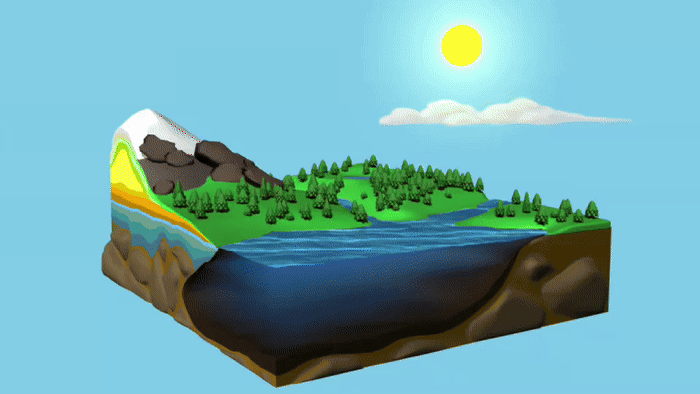

  

  Source: NASA/Goddard Space Flight Center

<h3 align="center">Hydroclimate Research | Water Resources Engineering</h3>

- 🎓 MSc student in Water Resources Engineering at **KU Leuven & VUB**
- 🔭 Currently analysing **Hydrological Cycle Biases in State-of-the-Art CMIP6 and/or CMIP7 Climate Models over the Congo Basin**
- 💬 Ask me about **how climate and the water cycle influence each other**
## Connect with me

## Languages and tools

**Scientific computing:** xarray · pandas · NumPy · CDO · NetCDF
